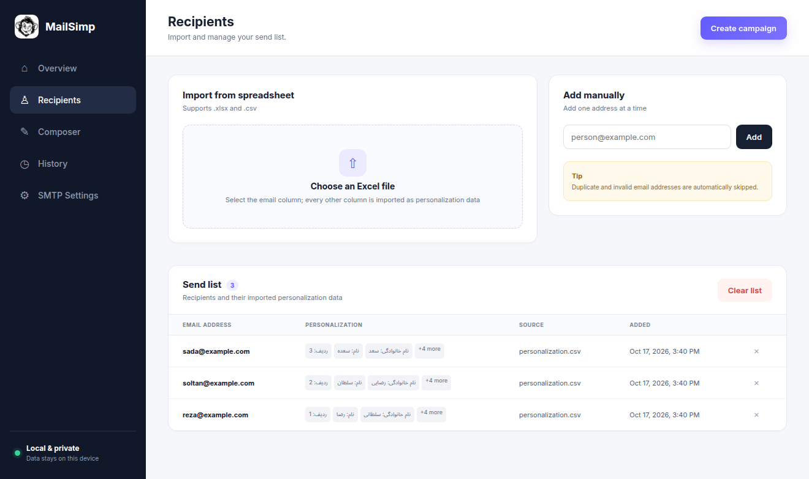
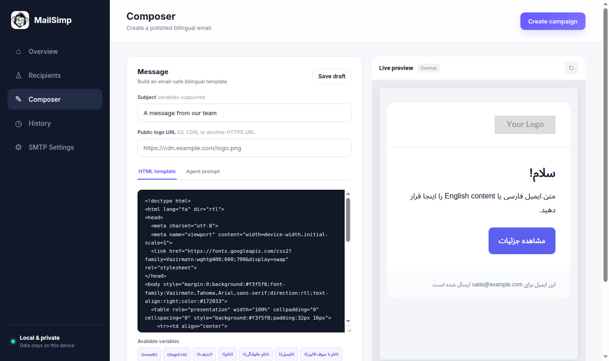

<div align="center">
  
  <h1>MailSimp</h1>
  <p>A simple, local-first desktop app for personalized email campaigns.</p>
  <p><a href="LICENSE">MIT License</a> · <a href="../../releases/latest">Latest release</a></p>
</div>

MailSimp imports recipients from a spreadsheet, lets you create bilingual HTML email, and sends it in controlled batches through an SMTP server you choose. Campaign data stays on your computer.

## Download

Prebuilt x64 binaries are attached to the [latest GitHub release](../../releases/latest).

| Platform | Download | Package |
| --- | --- | --- |
| Windows 10/11 | [Latest release](../../releases/latest) | `MailSimp-<version>-Windows-x64.exe` |
| macOS — Apple Silicon | [Latest release](../../releases/latest) | `MailSimp-<version>-macOS-arm64.dmg` |
| macOS — Intel | [Latest release](../../releases/latest) | `MailSimp-<version>-macOS-x64.dmg` |
| Linux | [Latest release](../../releases/latest) | `MailSimp-<version>-Linux-x86_64.AppImage` |
| Debian / Ubuntu | [Latest release](../../releases/latest) | `MailSimp-<version>-Linux-x86_64.deb` |

Each release also includes `SHA256SUMS`. On Linux, verify a downloaded binary with:

```bash
sha256sum --check --ignore-missing SHA256SUMS
```

If an AppImage cannot start because FUSE 2 is unavailable, use the `.deb` package instead.

The macOS builds are not code-signed or notarized unless the repository owner configures Apple signing credentials in GitHub Actions. On first launch, macOS may require you to approve the app in **System Settings → Privacy & Security**.

## Features

- Import `.xlsx` and `.csv` files with a column preview and selectable email field
- Keep every spreadsheet column available for per-recipient personalization
- Insert `{{variables}}` in subjects and HTML, including Unicode and Persian headers such as `{{نام}}`
- Validate email addresses and deduplicate recipients during import
- Compose English, Persian, and RTL-compatible HTML email with a Vazirmatn starter template
- Preview templates before sending and use publicly hosted logo images
- Configure any SMTP provider and send a real test email before a campaign
- Process campaigns in batches of 20 with a configurable pause between batches
- Inspect campaign history and individual delivery results
- Store recipients, templates, SMTP settings, and history locally in SQLite
- Run on Windows, macOS, and Linux without a hosted MailSimp service or account

## Screenshots

| Overview | Recipients |
| --- | --- |
|  |  |



## Quick start

1. Download and open the package for your platform.
2. Open **SMTP Settings**, enter your provider details, and send a test message.
3. Import a spreadsheet with an email column.
4. Write or paste an HTML template and add spreadsheet variables where needed.
5. Preview the campaign, confirm the recipient count, and send.

Use an app password if your email provider supports one. SMTP credentials are stored in MailSimp's local application database, so only run the app on a device and user account you trust.

## Development

MailSimp requires Node.js 22.12 or newer.

```bash
npm ci
npm start
```

Run the syntax checks and build the GitHub Pages site:

```bash
npm test
npm run site:build
```

Build local packages in `release/`:

```bash
npm run pack:linux # AppImage and .deb
npm run pack:win   # portable .exe
npm run pack:mac   # Intel and Apple Silicon .dmg/.zip (requires macOS)
```

Platform packages are built on their matching operating systems. Pull requests and pushes to `main` are built by [GitHub Actions](.github/workflows/build.yml).

## Publishing a release

Update the version in `package.json` and `package-lock.json`, commit the change, then push a matching version tag:

```bash
git tag v1.2.0
git push origin v1.2.0
```

The [release workflow](.github/workflows/release.yml) builds the Windows and Linux binaries, creates checksums, and publishes them to a GitHub release automatically. The [Pages workflow](.github/workflows/pages.yml) deploys the product website on every push to `main`.

## Responsible sending

Only email people who have agreed to hear from you. Follow your SMTP provider's sending limits and the anti-spam and privacy rules that apply to you. MailSimp is a sending tool; it does not manage consent, unsubscribe requests, or regulatory compliance for you.

## Contributing

Issues and pull requests are welcome. For a code change, keep the scope focused, run `npm test`, and describe how you verified the behavior. Please do not include real mailing lists, SMTP credentials, or campaign data in reports or fixtures.

## License

MailSimp is open-source software available under the [MIT License](LICENSE).
